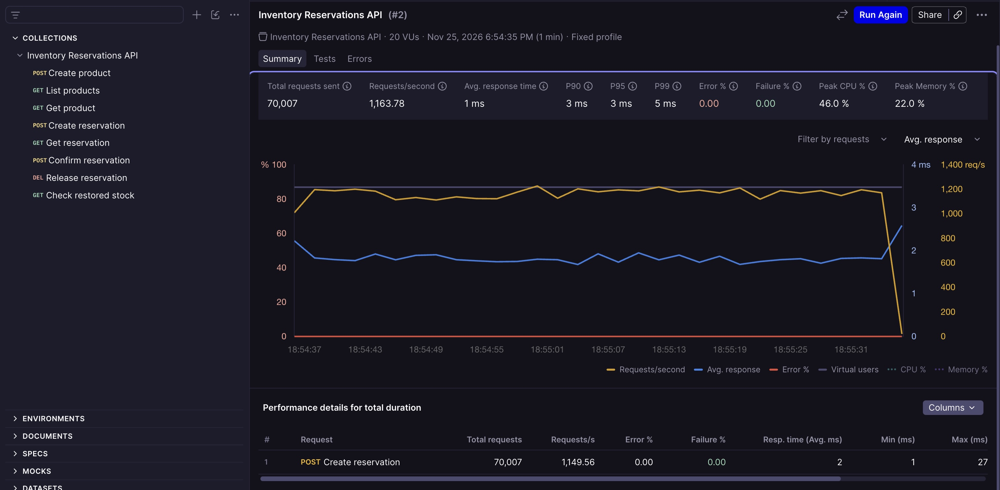

# ISSUE

## Test (_solved_)

### STR
```bash
(base) ... dotnet-coding-challenge % dotnet test
  Determining projects to restore...
  Restored --/unily/GIT/dotnet-coding-challenge/src/dotnet.challenge.data/dotnet.challenge.data.csproj (in 36 ms).
  Restored --/unily/GIT/dotnet-coding-challenge/src/dotnet.challenge.api/dotnet.challenge.api.csproj (in 107 ms).
  Restored --/unily/GIT/dotnet-coding-challenge/tests/dotnet.challenge.tests/dotnet.challenge.tests.csproj (in 117 ms).
  dotnet.challenge.data -> --/unily/GIT/dotnet-coding-challenge/src/dotnet.challenge.data/bin/Debug/net8.0/dotnet.challenge.data.dll
  dotnet.challenge.api -> --/unily/GIT/dotnet-coding-challenge/src/dotnet.challenge.api/bin/Debug/net8.0/dotnet.challenge.api.dll
  dotnet.challenge.tests -> --/unily/GIT/dotnet-coding-challenge/tests/dotnet.challenge.tests/bin/Debug/net8.0/dotnet.challenge.tests.dll
Test run for --/unily/GIT/dotnet-coding-challenge/tests/dotnet.challenge.tests/bin/Debug/net8.0/dotnet.challenge.tests.dll (.NETCoreApp,Version=v8.0)
VSTest version 17.11.1 (arm64)

Starting test execution, please wait...
A total of 1 test files matched the specified pattern.
[xUnit.net 00:00:00.07]     dotnet.challenge.tests.ConcurrencyTests.Reserve_UnderConcurrentLoad_NeverOversells [FAIL]
  Failed dotnet.challenge.tests.ConcurrencyTests.Reserve_UnderConcurrentLoad_NeverOversells [8 ms]
  Error Message:
   System.IndexOutOfRangeException : Index was outside the bounds of the array.
  Stack Trace:
     at System.Collections.Generic.Dictionary`2.TryInsert(TKey key, TValue value, InsertionBehavior behavior)
   at System.Collections.Generic.Dictionary`2.set_Item(TKey key, TValue value)
   at dotnet.challenge.data.Cache.SimpleObjectCache`2.AddAsync(TKey key, TValue value) in --/unily/GIT/dotnet-coding-challenge/src/dotnet.challenge.data/Cache/SimpleObjectCache.cs:line 11
   at dotnet.challenge.api.Services.InventoryService.TryReserveAsync(Guid productId, Int32 quantity, Int32 ttlSeconds) in --/unily/GIT/dotnet-coding-challenge/src/dotnet.challenge.api/Services/InventoryService.cs:line 60
   at dotnet.challenge.tests.ConcurrencyTests.<>c__DisplayClass2_0.<<RunIteration>b__3>d.MoveNext() in --/unily/GIT/dotnet-coding-challenge/tests/dotnet.challenge.tests/ConcurrencyTests.cs:line 47
--- End of stack trace from previous location ---
   at dotnet.challenge.tests.ConcurrencyTests.RunIteration(Int32 iteration) in --/unily/GIT/dotnet-coding-challenge/tests/dotnet.challenge.tests/ConcurrencyTests.cs:line 60
   at dotnet.challenge.tests.ConcurrencyTests.Reserve_UnderConcurrentLoad_NeverOversells() in --/unily/GIT/dotnet-coding-challenge/tests/dotnet.challenge.tests/ConcurrencyTests.cs:line 23
--- End of stack trace from previous location ---

Failed!  - Failed:     1, Passed:     5, Skipped:     0, Total:     6, Duration: 8 ms 
```

### Evidence

```bash
(base) ... dotnet-coding-challenge % dotnet test
  Determining projects to restore...
  Restored --/unily/GIT/dotnet-coding-challenge/src/dotnet.challenge.data/dotnet.challenge.data.csproj (in 35 ms).
  Restored --/unily/GIT/dotnet-coding-challenge/src/dotnet.challenge.api/dotnet.challenge.api.csproj (in 103 ms).
  Restored --/unily/GIT/dotnet-coding-challenge/tests/dotnet.challenge.tests/dotnet.challenge.tests.csproj (in 113 ms).
  dotnet.challenge.data -> --/unily/GIT/dotnet-coding-challenge/src/dotnet.challenge.data/bin/Debug/net8.0/dotnet.challenge.data.dll
  dotnet.challenge.api -> --/unily/GIT/dotnet-coding-challenge/src/dotnet.challenge.api/bin/Debug/net8.0/dotnet.challenge.api.dll
  dotnet.challenge.tests -> --/unily/GIT/dotnet-coding-challenge/tests/dotnet.challenge.tests/bin/Debug/net8.0/dotnet.challenge.tests.dll
Test run for --/unily/GIT/dotnet-coding-challenge/tests/dotnet.challenge.tests/bin/Debug/net8.0/dotnet.challenge.tests.dll (.NETCoreApp,Version=v8.0)
VSTest version 17.11.1 (arm64)

Starting test execution, please wait...
A total of 1 test files matched the specified pattern.

Passed!  - Failed:     0, Passed:     8, Skipped:     0, Total:     8, Duration: 2 ms - dotnet.challenge.tests.dll (net8.0)
```

### Live

